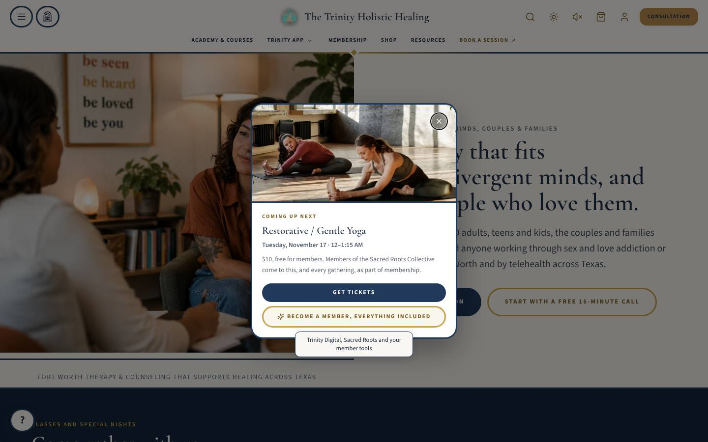
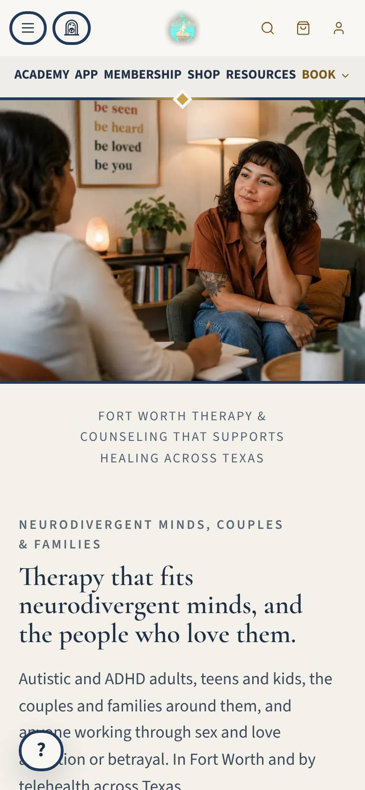

  

<h1 align="center"><a href="https://thetrinityholistichealing.com">The Trinity Holistic Healing</a></h1>

  A counseling, medicine and holistic wellness practice in Fort Worth, Texas, with care across Texas by video. Therapy, medical services, body work, spiritual healing and executive coaching sit under one roof, so people are met as whole people. The practice reaches its members through a website, a phone app, a desktop app, a browser extension and community bots on Discord and Telegram, all on one account.

<strong>Live site:</strong> <a href="https://thetrinityholistichealing.com">thetrinityholistichealing.com</a>

  <a href="#what-it-is">What it is</a> · <a href="#services">Services</a> · <a href="#features">Features</a> · <a href="#products">Products</a> · <a href="#team">Team</a> · <a href="#book-or-get-in-touch">Book</a> · <a href="#connected-brands">Connected brands</a>

  
  
  
  
  
  
  

<table>
  <tr>
    <td align="center" valign="top">
       
      The home page on desktop, with the four departments and booking up front.
    </td>
    <td align="center" valign="top">
       
      The same page on a phone.
    </td>
  </tr>
</table>

## What it is

The Trinity Integrative Holistic Medicine & Counseling Services is a Fort Worth practice founded by Vannah Hughes, M.A., LPC-Associate, LCDC, CSAT, RYT-200. It started from one conviction: healing happens through connection. Mental health care, family systems work, addiction recovery and holistic wellness share one practice, so a person does not have to stitch their care together from five places.

The website is the practice's front door and its member platform. Visitors can find the right therapist or practitioner, book a session, take a private screening, join a group, shop, and keep learning between appointments. The phone app, desktop app, browser extension and community bots all run on the same account, so a member's bookings, journal and community follow them from one screen to the next.

## Services

The practice at 610 S Jennings Ave, Ste C, Fort Worth, TX 76104 is organized into four departments. Each service has its own page on the site.

### Counseling and Medicine

Clinical care from licensed counselors and medical providers. See the [department overview](https://thetrinityholistichealing.com/departments/clinical/).

- **Counseling and therapy**: [neurodivergence integration and complex trauma therapy](https://thetrinityholistichealing.com/neurodivergence-complex-trauma-therapy/), [mental health treatment](https://thetrinityholistichealing.com/mental-health-treatment/), [depression therapy](https://thetrinityholistichealing.com/depression-therapy-fort-worth/), [child, adolescent and teen therapy](https://thetrinityholistichealing.com/children-adolescent-teen-therapy/), [family therapy](https://thetrinityholistichealing.com/family-therapy/), and [court, forensic and behavioral health services](https://thetrinityholistichealing.com/forensic-behavioral-health-services/)
- **Love and relationships**: [couples and marriage counseling](https://thetrinityholistichealing.com/couples-marriage-services/), [premarital and dating counseling](https://thetrinityholistichealing.com/dating-pre-marital-counseling/), [attachment styles and relationship therapy](https://thetrinityholistichealing.com/attachment-styles-relationship-therapy/), [partner betrayal trauma and infidelity recovery](https://thetrinityholistichealing.com/partner-betrayal-trauma-healing/), and [healing after narcissistic abuse](https://thetrinityholistichealing.com/healing-after-narcissistic-abuse/)
- **Sacred sexuality**: [sacred sexual reclamation for women](https://thetrinityholistichealing.com/sacred-sexual-reclamation-for-women/), [sacred sexuality for men](https://thetrinityholistichealing.com/sacred-sexuality-for-men/), and [erotic self-discovery](https://thetrinityholistichealing.com/erotic-self-discovery/)
- **Medical services**: [psychiatric medication management](https://thetrinityholistichealing.com/psychiatric-medication-management/), [chiropractic care](https://thetrinityholistichealing.com/chiropractic-care/), [acupuncture](https://thetrinityholistichealing.com/acupuncture/), and a [dietary nutritionist](https://thetrinityholistichealing.com/dietary-nutritionist/)
- **For clinicians and groups**: [clinical supervision for LPC-Associates in Texas](https://thetrinityholistichealing.com/clinical-supervision-lpc-associates-texas/) and [clinical therapy groups](https://thetrinityholistichealing.com/clinical-groups/)

### Wellness Center

Body care and everyday health through [wellness services](https://thetrinityholistichealing.com/wellness-services/): [massage](https://thetrinityholistichealing.com/massage-fort-worth/), [yoga and movement](https://thetrinityholistichealing.com/yoga-fort-worth/), [vitamins and supplements](https://thetrinityholistichealing.com/vitamins-supplements/), and [nutrition management](https://thetrinityholistichealing.com/nutrition-management/).

### Sacred Roots Community

Holistic, spiritual and experiential healing. See the [department overview](https://thetrinityholistichealing.com/departments/holistic/).

- **Holistic and body**: [eco-therapy](https://thetrinityholistichealing.com/eco-therapy-holistic-healing/), [Reiki](https://thetrinityholistichealing.com/reiki-energy-healing/), [sound bowl healing](https://thetrinityholistichealing.com/sound-bowl-healing/), and [breathwork](https://thetrinityholistichealing.com/breathwork-healing/)
- **Spiritual**: [tarot readings](https://thetrinityholistichealing.com/tarot-readings/), [spiritual channeling](https://thetrinityholistichealing.com/spiritual-channeling/), [cord cutting](https://thetrinityholistichealing.com/cord-cutting/), and [manifestation coaching](https://thetrinityholistichealing.com/manifestation-coaching/)
- **Experiential**: [music healing](https://thetrinityholistichealing.com/music-therapy/), [dance and movement healing](https://thetrinityholistichealing.com/dance-therapy/), [sports performance coaching](https://thetrinityholistichealing.com/sports-therapy/), and [therapy dog visits](https://thetrinityholistichealing.com/therapy-dog-services/)

### Executive Consulting

Coaching and planning for business owners and leaders: [executive retreats](https://thetrinityholistichealing.com/executive-retreats/), [financial planning](https://thetrinityholistichealing.com/financial-planning/), [technology consulting](https://thetrinityholistichealing.com/business-technology-consulting/), [entrepreneurial consultation](https://thetrinityholistichealing.com/entrepreneurial-consultation/), [performance optimization](https://thetrinityholistichealing.com/performance-optimization/), and [business coaching](https://thetrinityholistichealing.com/business-coaching/).

### Events, classes and community

Community nights and recurring [events](https://thetrinityholistichealing.com/events/), weekly [classes](https://thetrinityholistichealing.com/classes/), a [couples getaway](https://thetrinityholistichealing.com/couples-getaway/), and a way to [become a vendor](https://thetrinityholistichealing.com/vendors/) at an event.

## Features

### Booking and getting started

- **Book your way**: with a named clinician, or through the general scheduler
- **Real time slots**: Reiki, breathwork, sound and yoga are booked against each practitioner's actual hours
- **Free first call**: a [free 15-minute consultation](https://thetrinityholistichealing.com/free-consultation/) before you commit
- **Groups online**: therapy and recovery groups take sign-ups on the site

### The member platform

- **Free account, no password**: sign up with one email and sign in with a code sent to it
- **One dashboard**: what you have taken, bought and switched on, with upcoming sessions and the resources open to you
- **Private self-assessments**: well-established [screening questionnaires](https://thetrinityholistichealing.com/assessments/), with results saved to your account to bring to a session if you choose
- **Resource library**: over five hundred articles, worksheets, videos, directories and tools, sorted by topic and type
- **Journal**: streaks, streak freezes, achievements and a room that grows over the year
- **Optional trackers**: cycle and hormone tracking, daily astrology and a birth chart, each with its own on and off switch
- **Everyday tools**: an accountability partner, a couples tool, a family checklist with a weekly grocery list, and shared budgets with a settle-up
- **Your data, your call**: download it as CSV, Excel or PDF, with an optional send to your clinician
- **Community**: chat rooms by topic and private messages, including direct contact with the team
- **[Membership](https://thetrinityholistichealing.com/membership/)**: free and paid tiers, each opening more of the platform, changeable at any time

### Learning and shopping

- **[The Trinity Academy](https://thetrinityholistichealing.com/academy/)**: classes taught by the practice, with limited places and the option to pay in installments
- **[The Trinity Shop](https://thetrinityholistichealing.com/shop/)**: journals, apparel, mugs, art and accessories printed to order, including the Neurospicy Wear range and *From Pain to Power*, the founder's book
- **The Trinity Tarot**: a full 78-card deck renamed in the practice's language, seven spreads, and readings written against your question. It is offered for reflection, not advice, and not as a substitute for care
- **Reading and listening**: articles, a [podcast](https://thetrinityholistichealing.com/podcast/), downloadable guides and [research](https://thetrinityholistichealing.com/research/) you can contribute to

### Accessibility and privacy

- **Any screen**: phone, tablet or desktop, in light or dark mode, with keyboard navigation and screen-reader support
- **Crisis signposting**: forms that invite personal detail point to help. If you are in crisis, call or text 988
- **Data stays private**: clinical and personal data is access-controlled and never shared with advertisers, and card details go to the payment processor, never to the practice

## Products

The practice runs five products on one account and one membership.

- **Website**: [thetrinityholistichealing.com](https://thetrinityholistichealing.com) is the front door and the full member platform described above.
- **Mobile app (iOS and Android)**: the practice in your pocket, with five tabs: Home, Book, Events, Shop and Portal. Book sessions with member pricing applied, RSVP to events and check yourself in at the door, shop and take courses from one cart, and keep your journal, trackers, birth chart and couples tools close. It adds text size, dyslexia-friendly text, higher contrast and colorblind-friendly cues. [Get the app](https://thetrinityholistichealing.com/trinity-app/mobile/) or read [about the app](https://thetrinityholistichealing.com/trinity-app/).
- **Desktop app (macOS, Windows and Linux)**: the same app laid out for a computer, with a full-height side panel and lists beside their details. Updates are signed and install themselves, then wait for you to restart. The desktop installers live on the [releases page](https://github.com/ZATHENA-VENTURES/trinity-holistic-healing-desktop-releases/releases/latest), and the [download page](https://thetrinityholistichealing.com/download/) on the site points there too.
- **Browser extension**: keeps the practice one click away from any page. It shows your next session, the next three weeks of classes and events, and your notifications, with read on the website meaning read here too. Courses, chat, the shop, your journal and your portal are each one click away, and you can send any page to the practice as an idea or a bug report.
- **Community bots (Discord and Telegram)**: one membership, three places to be in it. Verify once and your member badge shows on both platforms. The site's community rooms are the same rooms on Discord and Telegram, synced both ways and anonymous. Nightly event listings link to each night's page, and you can ask the bot about the practice: hours, the team, services and reviews, answered from the website's own content.

## Team

Meet everyone on the [Meet Our Team](https://thetrinityholistichealing.com/meet-the-team/) page.

- **Vannah Hughes**: Chief Executive Officer, marriage and relational sex and intimacy expert (M.A., LPC-Associate, LCDC, CSAT, E-RYT-200, YACEP, ordained minister)
- **Michael B. Hughes-Isbell**: co-founder, Chief Technology and Digital Innovation Officer, and Director of Music and Spiritual Wellness
- **Dr. Rupal Patel**: Medical Director (MD)
- **Onika Davis**: Director of Nursing and Medical Research (DNP, PMHNP)
- **Cristian Tovar**: Director of Clinical Supervision and Professional Development (LPC-S, LCDC)
- **Eric Hinojosa**: individual and trauma therapist (M.A., LPC)
- **Joseph Cepeda**: child, adolescent and family therapist (LPC-Associate)
- **Brianna Swint**: trauma, family and individual therapist (M.A., LPC-Associate)
- **Myka Joles**: trauma, eating disorder and family therapist (M.A., LPC-Associate)
- **Hannah Eboagu**: registered and licensed dietitian for nutrition and performance (MCN, RD, LD, MHFA)
- **LaRhonda McCullough**: spiritual and Reiki practitioner and sound healer (LVN)
- **Heather Strickland**: Reiki master, yoga instructor and sound healer (E-RYT 500, YACEP)
- **Anya Zelinska**: tantra yoga teacher and somatic coach
- **Tom Hermann**: financial coach

## Book or get in touch

- **[Book a free 15-minute call](https://thetrinityholistichealing.com/free-consultation/)** to find the right fit
- **[Contact the practice](https://thetrinityholistichealing.com/contact/)**: the contact form gets a reply within 48 hours
- **[What to expect](https://thetrinityholistichealing.com/what-to-expect/)**, **[pricing](https://thetrinityholistichealing.com/pricing/)** and the **[FAQ](https://thetrinityholistichealing.com/faq/)** answer most first questions

## Connected brands

- **[Zathena Ventures](https://zathenaventures.xyz)**: the studio hub behind the wider ecosystem ([public repo](https://github.com/ZATHENA-VENTURES/ZathenaVentures-Public))
- **[Michael B. Hughes-Isbell Portfolio](https://michaelbisbell.com)**: the personal brand of co-founder Michael B. Hughes-Isbell ([public repo](https://github.com/ZATHENA-VENTURES/MBIM-Public))

## License

© 2026 The Trinity Integrative Holistic Medicine & Counseling Services, LLC. All rights reserved.

## Credits & Contact

The Trinity Integrative Holistic Medicine & Counseling Services, LLC, 610 S Jennings Ave, Ste C, Fort Worth, TX 76104.

Website: [thetrinityholistichealing.com](https://thetrinityholistichealing.com) · Contact: [contact page](https://thetrinityholistichealing.com/contact/) · Policies: [Privacy Policy](https://thetrinityholistichealing.com/privacy-policy/), [Terms of Use](https://thetrinityholistichealing.com/terms-of-use/), [Accessibility Statement](https://thetrinityholistichealing.com/accessibility-statement/)

> This is the public showcase of a private repository. It presents the project, its features and its live site, and leaves out source code and deployment details.
